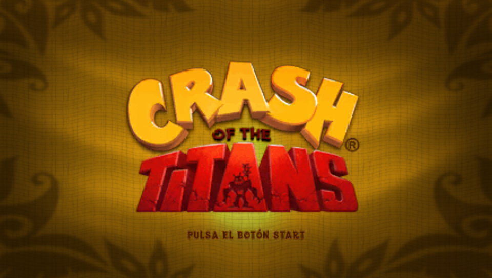
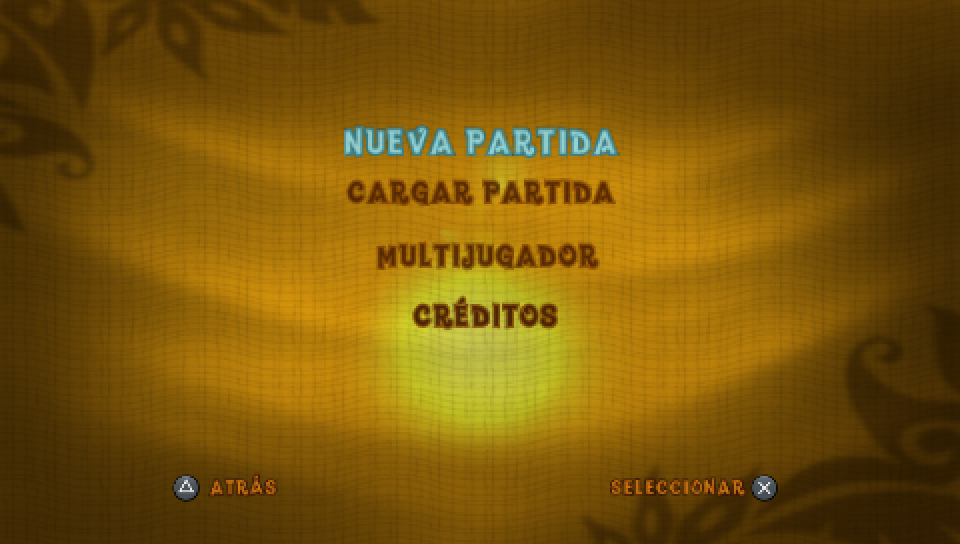
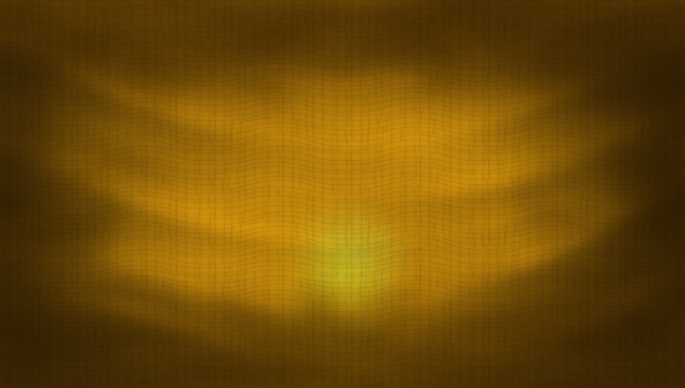

# Crash of the Titans (PSP) — port nativo a PC, sin emulador

Primera publicación mía en GitHub: pidan disculpas por el desorden y por no saber todavía cómo organizar bien las cosas acá (etiquetas, estructura, formato de las capturas). Si alguien sabe cómo debería armarse un hilo así, me avisa y lo ordeno.

## Qué estoy haciendo

Un **port nativo a PC** de *Crash of the Titans* (PSP, ULES00915). No es un emulador y tampoco es un juego nuevo hecho desde cero: es el código del juego original corriendo en mi máquina sin capa de emulación.

## Método

Lo que hay hasta ahora, en orden:

1. **Recompilación anticipada (AOT) del binario original.** Tomo el `BOOT.BIN` de MIPS de PSP y lo traduzco a C++ (unos 90 objetos compilados por separado). No reescribo la lógica del juego a mano: el comportamiento viene del binario de Vivendi/Vicarious, decompilado y vuelto a compilar para x86-64.
2. **Reimplementación de los servicios de PSP que el binario llama**, en el host nativo: kernel (hilos, semáforos, colas de eventos, flags), `sceDisplay` con su latch de framebuffer, y las listas de comandos del GE (el GPU de PSP).
3. **Rasterizador por software propio** que emula el pipeline del GE (blend, texturas, scissor) sobre un framebuffer en memoria, y presentación en ventana con OpenGL/GDI.
4. **Assets originales** de la ISO, sin reemplazar ni regenerar nada.

La vara que me puse es dura a propósito: en modo fiel, el cuadro del título tiene que dar el **mismo hash** que el de la implementación de referencia (PPSSPP con la misma ISO). Si un cambio mueve un píxel, se descarta.

## Estado actual (honesto)

Ya dibuja imagen real del juego y ya pasó del título al menú, pero la cadencia todavía es de **~2,8 cuadros distintos por segundo** a resolución nativa en esta máquina. Es decir: el camino gráfico está abierto, la velocidad no, y sigo a un orden de magnitud del objetivo.

El número sale de una corrida con ventana abierta y con el reloj del juego avanzando **1,000 s por cada segundo real**, así que no hay turbo ni frame-skip inflándolo; y rechazo los promedios del arranque (casi no rasterizan): leo el cierre de la corrida. Lo que medí hoy:

- **20,5 Mpx/s** de relleno por software. Una parte de la lentitud de los últimos días era **mi propia vara**: con la verificación caja a caja encendida el raster se caía a 9,0 Mpx/s. Ahora esa verificación es opt-in y el throughput volvió a subir.
- **Corregi un número que había publicado mal.** La escalera por escala de pantalla que había dejado escrita (1x ≈ 17,6 · 2x ≈ 4,4 · 3x ≈ 2,0 · 1080p ≈ 1,1) estaba **3 veces optimista**: contaba las capas por lista de comandos del GE, y un cuadro del nivel usa ~3 listas. Refrescada la cuenta por cuadro, el mismo motor da **1x ≈ 6,0 · 2x ≈ 1,5 · 3x ≈ 0,7 · 1080p ≈ 0,4**. Ese número sí cierra con lo que veo en la ventana: 3,00 cuadros presentados por segundo a 1x con el reloj en 1,000. O sea a 2x la proyección es **~1,5 cuadros por segundo**, no 4,4. El número anterior no lo sostenía la mano.
- La cadencia viene clavada en **2,9-3,0 cuadros distintos por segundo** desde hace cuatro builds, y el relleno en ~21 Mpx/s también: sacando toda la instrumentación del camino caliente el número no se mueve (21,1 Mpx/s), o sea la medición ya no me está cobrando el cuadro. Lo que falta es el costo del propio pixel.

La autopsia del sobre-dibujo que prometí abajo ya está medida, y me cambió el culpable:

- Por cuadro presentado se escriben **~3,4 millones de píxeles** sobre una pantalla de 130.560. De ésos, los que cambian de verdad son ~86.000: **~40 pasadas** de sobreescritura (contra el viewport completo serían ~26 capas por cuadro). Yo estimaba ~72 pantallas; el orden de magnitud era ése.
- El recorte por bounding box ya está flaco: los píxeles candidatos a dibujar son **1,0 veces** los que se escriben. O sea el derroche no está en pintar fuera de pantalla, está entre las capas.
- Y acá me equivoqué: el clear de un viewport completo rinde **928.000 px/ms**, contra **5.800 px/ms** de un triángulo. Un clear es ~160 veces más barato por píxel, así que saltearse los clears que después se tapan (pasan en el 66 % de los cuadros) casi no paga. El costo real es el inner loop del rasterizado de triángulos.
- Y dentro de ese inner loop, **no hay una sola fase culpable**: apagando una fase por corrida (mismo ejecutable, misma escena) el píxel de ~166 ns sale repartido en bloques de 40-53 ns — cobertura e interpolación 50,4 ns (30 %), búsqueda del texel 53,0 ns (32 %), escritura 39,1 ns (23 %); y probar la profundidad contra el búfer sale gratis (5.865 vs 6.006 px/ms, dentro del ruido), o sea un pre-pass de Z no me da nada. Para redondear: a 30 fps el presupuesto es ~200.000 px/ms y hoy tengo ~21.000. Son **34 veces**, y no las cierra una técnica elegante sino achicando varios bloques a la vez.

Las capturas son del port, volcadas desde el framebuffer nativo a **480x272** (resolución interna real de PSP); las agrandé a 960x544 con vecino más cercano para que se lean, sin suavizar ni inventar detalle.

## Objetivos

Lo que quiero llegar a conseguir, en este orden:

- **Rendimiento primero en CPU**, porque la meta es que se mueva bien en hardware humilde: 60 fps sostenidos con escalado 2x (960x544) y después 3x. Hoy mido **20,5 Mpx/s** de relleno. Si cada píxel se escribiera una sola vez, 2x@60 pediría ~31 Mpx/s y estaría cerca; con el sobre-dibujo real del nivel (~26 capas por cuadro) la cuenta pasa a ~800 Mpx/s. Ahí está el problema, y no es la suerte: es el rasterizador.
- **Escalera de fps reales, sin trampa**: 60 → 120 → 240 como opciones. Nada de frame-skip ni de "turbo" (acelerar el reloj del juego como pasa en PSP): la métrica de control es que el reloj del juego avance 1,000 s por cada segundo real, y que los cuadros presentados sean cuadros distintos.
- **Escalera de calidad hasta 4K** (720p, 1080p, 2K, 4K) como **opción dejada lista** para cuando tenga una gráfica más potente, no para esta máquina.
- **Entrada nativa**: mando de Xbox, teclado y mouse los tres, sin mapeos roñosos.
- **Cámara libre** con mouse o con el stick derecho, en opción. Esto la PSP no lo tenía; lo quiero como plus opcional, apagado por defecto para no romper la fidelidad.
- Y el paso que falta antes de todo lo vistoso: **que se pueda jugar un nivel entero**.

## Hardware en uso

| | |
|---|---|
| CPU | AMD Ryzen 5 5500 (6 núcleos / 12 hilos) |
| RAM | 16 GB |
| GPU | NVIDIA GeForce GT 440 1 GB |

La GT 440 no tiene CUDA ni soporte moderno, así que todo el trabajo pesado hoy está del lado de la CPU. La referencia que quiero superar es PPSSPP en esta misma máquina: 50-60 fps estables a 2x.

## Próximos días

Voy a ir subiendo más información: el histograma de áreas de primitivas, la cadencia de listas del GE por cuadro presentado, y las medicaciones de fps con la métrica anti-aceleración. La autopsia del sobre-dibujo ya la cerré y está arriba (eran ~40 capas por cuadro, y el clear resultó no ser el cuello). Lo que sigue es el inner loop del triángulo. También más capturas cuando haya gameplay.

Preguntas, correcciones y golpes de realidad, bienvenidos. Si alguien ya hizo un port AOT de un juego de PSP (o conoce material sobre el GE y su pipeline de blend), me interesa muchísimo leerlo.

